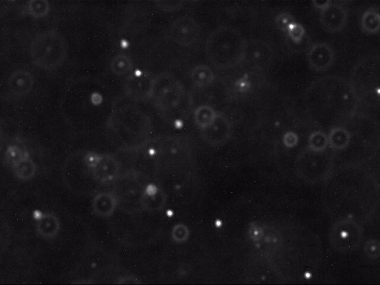

<h1 align="center">The Atomic Nature of Matter</h1>

<p align="center">
  <strong>Follow microscopic beads in motion. Estimate the constants behind it.</strong>
</p>

<p align="center">
  <a href="https://www.cs.princeton.edu/courses/archive/fall26/cos126/project/">
    
  </a>
  
  
</p>

<p align="center">
  
</p>

<p align="center"><sub>A frame from the included Brownian-motion microscopy dataset.</sub></p>

This project recreates a modern version of Jean-Baptiste Perrin's experiment: detect polystyrene beads in microscope images, measure their motion between frames, and use the displacement data to estimate the Boltzmann constant and Avogadro's number.

> **Course reference:** [The Atomic Nature of Matter — Princeton COS 126](https://www.cs.princeton.edu/courses/archive/fall26/cos126/project/)

## How it works

```mermaid
flowchart LR
    A["Microscope frames"] --> B["Luminance threshold"]
    B --> C["Find connected blobs"]
    C --> D["Keep bead-sized blobs"]
    D --> E["Track between frames"]
    E --> F["Measure displacements"]
    F --> G["Estimate k and Nₐ"]

    classDef data fill:#e8f1f5,stroke:#286983,color:#17313d
    classDef process fill:#fff3d6,stroke:#c58b22,color:#44310d
    classDef result fill:#e6f4ea,stroke:#43845a,color:#183d24
    class A,F data
    class B,C,D,E process
    class G result
```



The image processor thresholds pixels by luminance, then uses depth-first search to find 8-connected components. Small components are discarded; the remaining bead centers are compared across consecutive frames. The resulting radial displacements are converted from pixels to meters and used to estimate the diffusion constant, Boltzmann constant, and Avogadro's number.

## Run it

You'll need a JDK with `javac` and `java` available on your `PATH`. Run these commands from the repository root.

### Windows (PowerShell)

```powershell
$javaFiles = Get-ChildItem .\src -Recurse -Filter *.java | ForEach-Object { $_.FullName }
New-Item -ItemType Directory -Force .\out | Out-Null
javac -d .\out $javaFiles
java -cp .\out Core.Main 25 180.0 25.0 .\src\Dataset\run_1
```

### macOS / Linux

```bash
mkdir -p out
javac -d out $(find src -name '*.java')
java -cp out Core.Main 25 180.0 25.0 src/Dataset/run_1
```

The program prints estimates for the Boltzmann constant and Avogadro's number. It also writes the measured displacements, one per line, to `displacements-run_1.txt` in the current working directory.

## Arguments

| Argument | Meaning | Example |
| --- | --- | --- |
| `minPixel` | Minimum pixels for a connected component to count as a bead | `25` |
| `tau` | Luminance threshold for separating foreground from background | `180.0` |
| `delta` | Maximum bead-to-bead distance, in pixels, to accept as a match | `25.0` |
| `folderAddress` | Directory containing the run's JPEG frames | `src/Dataset/run_1` |

The included dataset folders are `run_1`–`run_4` and `run_8`–`run_10`; each contains 200 sequential JPEG frames. To process another run, replace the input folder. The output filename is generated automatically from that folder's name.

## Project layout

```text
src/
├── Core/         # Entry point and processing coordinator
├── Dataset/      # Microscope image sequences for the included runs
├── Interfaces/   # Component interfaces and factory
├── Models/       # Blob and picture models
└── Utilities/    # Thresholding, bead detection/tracking, and calculations
```

## Notes

- Frame filenames are zero-padded (`frame00000.jpg`, …), so they are processed in sequence.
- `delta` and the displacement output are in pixels; pixel-to-meter conversion and the experiment's physical constants are handled by the calculation code.
- The output file is named from the input folder (for example, `run_2` produces `displacements-run_2.txt`) and is written relative to the directory from which the program is launched.
